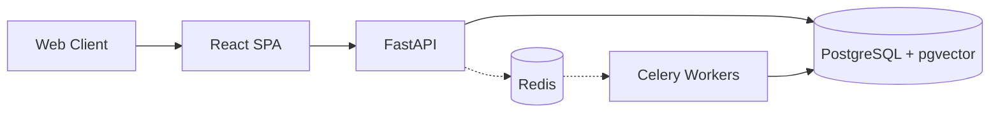

<div align="center">

  <h1>⚖️ JurisPulse</h1>

  

  <p>
    <b>JurisPulse is a legal workflow platform built for the Indian legal ecosystem.</b><br/>
    It connects case management, physical document processing, and AI-assisted research into a single, cohesive interface.
  </p>

  <p>
    <a href="https://react.dev/"></a>
    <a href="https://www.typescriptlang.org/"></a>
    <a href="https://fastapi.tiangolo.com/"></a>
    <a href="https://www.postgresql.org/"></a>
    <a href="https://redis.io/"></a>
    <a href="https://docs.celeryq.dev/"></a>
    <a href="https://www.docker.com/"></a>
  </p>

  <p>
    <a href="./PROJECT_STRUCTURE.md"><b>Architecture</b></a> •
    <a href="./docs/"><b>Documentation</b></a>
  </p>

</div>

---

## 📖 The Vision

JurisPulse is designed to solve a fundamental problem in Indian legal practice: fragmentation. Client communication, physical document parsing, and legal research typically occur across disconnected tools. 

JurisPulse brings these workflows into a unified, programmable environment.

### 🚀 Product Overview

| Module | Purpose |
| --- | --- |
| **Case Intelligence** | Client management, case timelines, and automated hearing tracking. |
| **Document Intelligence** | Tesseract OCR ingestion, layout parsing, and semantic chunking. |
| **Legal Research** | pgvector-backed semantic search across historical case laws. |
| **AI Workflows** | LLM-assisted drafting and hallucination verification services. |

## 🚧 Project Status

**Active Development**

JurisPulse is in active feature development, connecting case management, physical document processing, and AI-assisted research into a single, cohesive interface.

### Current Implementation

- **Case & Client Management**: Full case lifecycle management, automated court hearing schedules, order tracking, and client communication workflows.
- **Document & OCR Ingestion Pipeline**: Asynchronous multi-page legal document ingestion powered by Tesseract OCR, layout parsing, and semantic chunk extraction.
- **Legal Entity Timelines**: Chronological milestone tracking, hearing dates, and automated procedural reminders.
- **Semantic Legal Research**: Vector retrieval with `pgvector` indexing historical Indian Supreme Court and High Court precedents.
- **AI-Assisted Drafting**: Context-aware legal drafting for bail petitions, pleadings, notices, and affidavits.
- **Hallucination Verification**: Citation checking and proposition verification cross-referencing AI outputs against canonical legal databases.
- **Asynchronous Task Architecture**: Distributed Celery task execution on Redis for OCR, document embedding, background indexing, and real-time notifications.
- **Security & Multi-Tenancy**: Enterprise RBAC, strict tenant data isolation, secure authentication, rate limiting, and HTTP security headers.
- **Testing & Quality Gates**: Unit and integration test suites for both frontend and backend with GitHub Actions CI workflows.
- **Containerized Deployment**: Multi-stage Docker configurations, Nginx reverse proxy, and Docker Compose orchestration.

## 🏗️ Architecture



The system is separated into three core domains:
- **Frontend Layer**: A React SPA handling UI state, interactive case timelines, and data visualization.
- **API Layer**: A FastAPI application mapping business logic to REST endpoints with JWT auth and rate limiting.
- **Asynchronous Layer**: Celery workers polling Redis for intensive tasks including OCR, embeddings, and notification broadcasts.

## 💻 Technology

| Layer | Core Technologies |
|---|---|
| **Frontend** | React 19, TypeScript 6, Vite, Tailwind CSS, Zustand |
| **Backend** | Python 3.11+, FastAPI, SQLAlchemy (Async), Alembic |
| **Database** | PostgreSQL (asyncpg), pgvector extension |
| **Async Workers** | Celery, Redis |
| **Infrastructure** | Docker, Docker Compose, Nginx |

## 📂 Repository

```text
JurisPulse/
├── frontend/           # React 19 SPA & Design System
├── backend/            # FastAPI application & Celery workers
├── infrastructure/     # Docker, Docker Compose, Nginx configs
├── docs/               # System documentation & API specs
├── scripts/            # Health checks, test runners & security audit
├── tests/              # Test suites & quality gates
└── .github/            # GitHub Actions CI workflows
```

For a detailed breakdown of the internal architecture, see [PROJECT_STRUCTURE.md](./PROJECT_STRUCTURE.md).

## 🚀 Getting Started

### Prerequisites
- **Docker & Docker Compose** (Recommended) or
- **Node.js** (v18+) & **Python** (3.11+) with **PostgreSQL** & **Redis**

### Quickstart with Docker (Recommended)
```bash
docker compose -f infrastructure/docker/docker-compose.yml up --build
```
This spins up the API, Celery worker, PostgreSQL (with pgvector), and Redis automatically.

---

### Manual Local Setup

#### 1. Environment
```bash
cp backend/.env.example backend/.env
cp frontend/.env.example frontend/.env
```
Update `.env` files with your local configuration.

#### 2. Backend API
```bash
cd backend
python -m venv .venv
source .venv/bin/activate  # Windows: .venv\Scripts\activate
pip install -r requirements.txt

# Run migrations and start server
alembic upgrade head
uvicorn app.main:app --reload --port 8000
```

#### 3. Frontend SPA
```bash
cd frontend
npm install
npm run dev
```

## 📚 Documentation

| Document | Purpose |
| --- | --- |
| [Architecture](./PROJECT_STRUCTURE.md) | High-level system architecture and repository map. |
| [System Design](./docs/architecture/SYSTEM_DESIGN.md) | Detailed technical architecture and data flow. |
| [API Reference](./docs/api/OVERVIEW.md) | OpenAPI specification and endpoint documentation. |
| [Database Schema](./docs/database/SCHEMA.md) | Relational and vector schema documentation. |
| [Deployment Guide](./docs/deployment/DEPLOYMENT.md) | Production Docker, Nginx, and cloud deployment. |
| [Development Workflow](./docs/development/SETUP.md) | Guidelines for local setup, branching, and testing. |

## 📄 License

This project is proprietary and confidential. All rights reserved.
